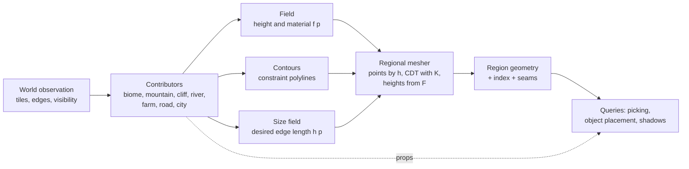

# Surface meshing: a third-generation model

**The surface mesher contract was accepted on 12 October (decisions D1-D3 below, as recommended) and implemented through steps 1-5 of section 5: size field, cliffs from map data, a stage pipeline with contributors, 16x16 regions with exact seams, background publication; open are step 6 (improvement and city contributors) and the coastal cliffs up to the reference (M1.1).** State as of 19 October 2026; the render status is in platform/docs/ui-render.md. The numbering D1-D3 belongs to this document, not to platform/PLATFORM.md or the L&L DECISIONS.md. The design is the contract of milestone M1 from ru/PLAN.en.md (the full text of the milestone is in ru/docs/archive-en/PLAN-2026-10-19-full.md).

12 October 2026. Based on the code of the two earlier approaches (`nation-old/.../terrain/fields.rs`, `evaluator.rs`, `lattice.rs`; sandbox `surface.rs`, `surface/field.rs`, `hydrology.rs`, `transitions.rs`, `mountains.rs`) and on `architecture-transfer.md` (study R-08-nation-surface-model, kept outside this repository).

## 1. What the two earlier approaches taught

| | Hex patches (nation-old, v28) | Uniform CDT (sandbox) |
|---|---|---|
| Identity of shared points | **Integer lattice**: a corner and an edge midpoint are one key for the neighbours, so cracks are impossible by construction | Matching float coordinates; there are no seams between regions because there are no regions |
| Evaluator = mesh | **By construction**: the same 24 triangles in `sample_surface` | In effect: `sample_ground` reads the final mesh through bins |
| Local rebuild | A tile patch is independent, O(tiles) | Only the whole map, synchronously (~145 ms) |
| Where the detail is | The same everywhere: 24 triangles per hex | The same everywhere: step 0.32 |
| Silhouette | Follows the hex, the visible lines coincide with the 6 edges | Independent of the hex, the contours of the coast and riverbed are sharp edges |
| Extensibility | Transitions are hard-wired into `BoundaryField`, a new shape = a core edit | Every new shape = a branch inside `vertex()`: arrays, mountains (a post-pass over the finished mesh), river bank, `coastal_rock` noise |

Conclusion: from the hexes we take the **shared-boundary contract and the evaluator by construction**, from the CDT the **independence from the hex and contours as constraints**. We take neither a fixed number of triangles, nor one global step, nor "everything in one function".

## 2. The model: five layers with explicit contracts

### 2.1 Contributor

The unit of extension. Any landscape shape - biome, mountain massif, hill, cliff edge, river, coast, farm, quarry, road, city - is a contributor. It **reads only the world observation and never reads the mesh**. It provides:

| Output | What it is | Example |
|---|---|---|
| Footprint | A bounded area of influence | the circle of a massif, a strip along an edge, a farm hex |
| Height operation | One of three: `Add(Δ)`, `Transform(y → f(p, y))`, `Clamp` | mountain: Add; cliff: Transform; contact with water: Clamp |
| Material operation | An override in a strip with a weight | beach sand, stone, wet earth, ploughed land |
| Contours | Polylines that must become mesh edges, with a protection radius | coast, riverbed, cliff brow and foot, cracks, terrace edge, edge of the city plateau |
| Density request | Edge length within a strip | cliffs 0.06-0.1; coast 0.15; plain 0.45 |
| Objects | Model instances where the height field cannot express the shape | boulders at the foot, overhangs, trees |

One contributor = one file with tests of its own invariants. A new biome or improvement is added by a contributor and data, not by editing the mesher.

### 2.2 Field: a fixed order of stages

The order of stages is fixed; the order of contributors inside a stage follows a stable key. This replaces the implicit sequence inside the current `vertex()`.

| Stage | Operation | Who |
|---|---|---|
| 1. Base | a weighted blend of tiles (as `base()` now), taking visibility into account | biomes |
| 2. Shapes | `Add`, summed | mountain massifs, hills, a rising headland, dunes |
| 3. Hydrology | `Transform` by profiles | sea and coast, riverbed and river bank, lake |
| 4. Cutouts | `Transform`, on overlap a **partition of unity** (a weighted blend by distance to the footprint) | cliff edges, terraces, quarry, city plateau |
| 5. Protection | `Clamp`: contact with water exactly at the level, finiteness, no inversions | mesher |

The partition of unity in stage 4 makes the result commutative: two overlapping cutouts give one surface in whatever order they were registered. This is the answer to "how to join the different parts to each other".

The material goes through the same stages; on top of it the GPU side still picks a per-face colour for steep rock and snow.

### 2.3 Contours

Constraint polylines of the CDT. They already exist for the coast and riverbeds; the cliff brow, foot and cracks, terrace and plateau edges and the **region seams** are added. Intersections of contours are resolved by `add_constraint_and_split` - deterministically, provided both sides see the same contours (see the halo in 2.5).

### 2.4 Size field and point placement

`h(p)` = the minimum over the contributors' requests, with global bounds 0.06 ≤ h ≤ 0.45. The plain gets large triangles, the cliffs small ones, with no common step.

Point placement: a **hierarchical lattice with per-level jitter** 0.48 / 0.24 / 0.12 / 0.06. A cell of level k yields a point if its size is the smallest one that is still not below `h`. The levels of neighbouring cells are **balanced 2:1**. The jitter is a hash of the cell, as now. Points closer than 0.3·h to a contour are discarded.

Why not Delaunay refinement (it exists in `spade 2.15`): refinement inserts vertices on constraints, including on the seams, and these vertices are not canonical - the neighbouring region would not repeat them. A balanced 2:1 lattice gives bounded triangle shape without refinement, and the seams stay canonical.

### 2.5 Regions, halo, seams

- A region is a block of hexes (we start with 16x16 and compare 8x8 and 32x32 by measurement). The region boundary runs along hex edges, that is, along the **integer lattice** of `lattice.rs`.
- The halo is rings of tiles around the region covering the maximum dependency radius of the field (currently 3.0 world at the coast, 2.65 at a massif, so 3 rings). The region is built from a "region + halo" snapshot; the neighbours compute the same field at the shared points because the inputs coincide.
- A seam is a chain of hex edges on the boundary. Each edge is divided into `n = ceil(len / h_seam)` equal parts, where `h_seam` is the minimum of the size field along the edge, taken at fixed points. The seam vertices = `lattice_to_world(lerp(a, b, k/n))` - one function, the same inputs, **bit-identical coordinates** on both sides. The seam is inserted as a chain of constraints into both regions, so a T-junction is impossible by construction, like the corners in `lattice.rs`.
- LOD: region level L scales the size field by 2^L. A seam between regions of different levels is divided by the **coarser** of the two levels; both regions know the neighbours' levels at the input (it is part of the dependency version). A change of the neighbour's level rebuilds the seam, that is, both regions, in the background.
- A build task receives an immutable snapshot and versions; it is published only if still current; until then the previous geometry lives on (as recorded in architecture-transfer.md).

### 2.6 Queries

Picking, object placement, the road and shadows read **only the final mesh** through the region index (a uniform grid of triangle lists, like the current bins, but per region). The invariant of the old evaluator is kept: there is no second height function that the mesh could diverge from. Contributor objects (boulders, overhangs) are placed after the mesh by the same query.

## 3. How this answers the four requirements

**Reliable.** Determinism: hash jitter, an integer seam lattice, a stable order of contributors. Invariants in tests:
1. Seam: every vertex and every edge of the seam exists in both neighbours, bit for bit.
2. Differential: the whole map and the same map by regions give equal heights at shared points (≤ 1e-5).
3. Contact with water: the shared edge of a wet and a dry triangle has one height (exists).
4. Independence from the hidden world: editing an unknown tile does not change the known geometry (exists).
5. Density: in the cliff strip an edge is ≤ 1.5·h; on the plain the number of triangles of a region is ≤ the budget.
6. Quality: the minimum triangle angle is ≥ 20° away from contour intersections.
7. A stale task is not published.

**Fast.** An estimate for a 16x16 region (≈ 28 × 24 world): a plain at h = 0.45 is ≈ 6.6 thousand triangles; a cliff coast of ≈ 30 world length in a strip of 0.8 at h = 0.08 is ≈ 7.5 thousand. In total about 14 thousand per coastal region against the current 50 thousand for the whole island. A map of 25 thousand tiles is ≈ 100 regions, so at full detail ~1.4 million triangles - hence **LOD of distant regions and assembling only the known regions are mandatory**, not an option. This is an estimate before measurement; the first measurement is after M1.1 on the current island.

**Beautiful.** Sharp low-poly edges where they are needed (brow, foot, crack, terrace edge), small facets only in the silhouette strip, flat normals on rock, large planes on the plain. Cracks are the contours "brow → foot" plus a displacement field, not noise on the vertices.

**Extensible.** Adding a biome = tile data plus, if needed, a material contributor. Adding a mountain of another type = a stage-2 contributor. Sheer cliffs = a stage-4 contributor driven by the edge flag. A farm on a hill = a stage-4 contributor with terrace contours. A city = a plateau contributor plus objects. None of them touches the mesher.

## 4. Where the current code goes

| Now | Becomes |
|---|---|
| `transitions.rs`: profiles of beach, ledge, river bank | Stay as profiles of the hydrology and cutout contributors |
| `field.rs::vertex()` - one function for everything | A pipeline of stages 1-5 over the region's list of contributors |
| `field.rs::base()` | The biome contributor (stage 1) |
| `hydrology.rs` | The river and coast contributor: profiles, contours, density |
| `mountains.rs::apply` - a post-pass over the mesh | The massif contributor (stage 2): shape in the field, density along the ridge |
| `coastal_rock` noise | The rocky-edge flag from the generator (decision Q3 in ru/PLAN.en.md) |
| `surface.rs::build` - one global CDT | The region builder: snapshot + halo → points → CDT → heights → index |
| `bins` per map | An index per region |
| Linear search of the coast and riverbed | Per-region segment lists |

## 5. Implementation order (M1 from ru/PLAN.en.md)

1. **Size field and point placement** on the current global CDT, without regions. The cliff strip gets 0.08, the plain 0.45. The first measurement of triangles and time.
2. **Cliff contours**: brow, foot, cracks from the displacement field; walls between them. A reference frame next to the reference image.
3. **Stage pipeline and contributors** instead of `vertex()`: biomes, massifs, hydrology, cliffs. A differential test "old `vertex()` = new pipeline" for the duration of the move.
4. **Regions and seams**: the region builder, halo, canonical seam, index. A differential test "whole = by regions".
5. **Background and versions**: build tasks, publication by currency, LOD by seam level.
6. Contributors for improvements and the city: terraces, quarry, plateau.

Steps 1-2 give a visible result for the cliffs, steps 3-5 performance and extensibility. The full Classic terrain set (M1.4 in ru/PLAN.en.md) lands on step 3 as contributors.

## 6. Decisions (accepted on 12 October as recommended)

| | Question | Decision | Why |
|---|---|---|---|
| D1 | How to divide the world into regions? | **Blocks of hexes, seams along hex edges on the integer lattice; size 16x16 until measured** | The lattice already gives exact point identity; seams along tile edges coincide with the borders of knowledge and ownership |
| D2 | How to place points? | **A balanced hierarchical lattice driven by the size field, no Delaunay refinement** | Refinement breaks the canonical seams; 2:1 balancing gives triangle quality without it |
| D3 | How to combine overlapping cutouts (cliff + terrace + plateau)? | **A partition of unity by distance to the footprint** instead of priorities | Commutative and continuous; priorities create seams on the border of two cutouts and depend on the registration order |

A height surface without overhangs remains a deliberate limitation: overhangs, arches and caves only as contributor objects.
